<p align="center">
  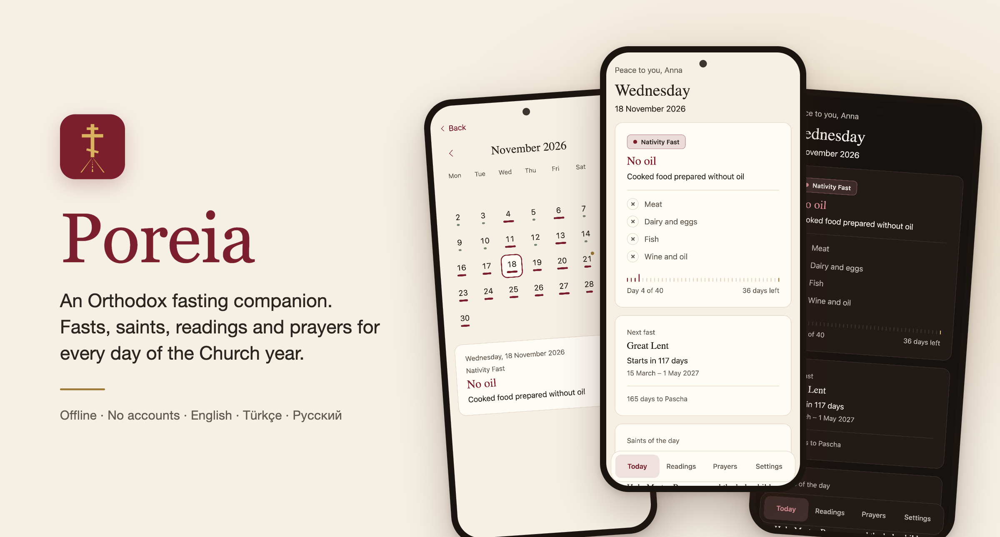
</p>

<h1 align="center">Poreia</h1>

<p align="center">
  An Orthodox fasting companion for Android.<br>
  The fast of the day, the saints, the readings and the prayers of the Church, on your phone and offline.
</p>

<p align="center">
  <a href="https://github.com/Kw4nzah/Poreia/releases/latest"></a>
  <a href="https://github.com/Kw4nzah/Poreia/actions/workflows/ci.yml"></a>
  
  
  
</p>

<p align="center">
  <a href="https://github.com/Kw4nzah/Poreia/releases/latest"><b>Download the APK</b></a>
  ·
  <a href="#what-it-does">What it does</a>
  ·
  <a href="#privacy">Privacy</a>
  ·
  <a href="#sources">Sources</a>
  ·
  <a href="#development">Development</a>
</p>

---

*Poreia* (πορεία) is Greek for a journey or a way. The app answers one question each morning:
**what does the Church ask of me today?** It shows the fasting rule for the day, how far along
the current fast is, the saints who are remembered, the Epistle and Gospel that are read, and
the prayers for morning, evening and the table.

It is free, has no accounts and no advertising, and keeps working without a connection.

## A minute with Poreia

<table>
  <tr>
    <td width="300" valign="top">
      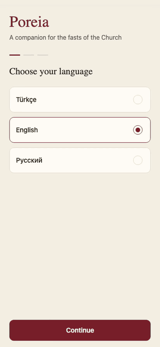
    </td>
    <td valign="top">

**First run.** Three questions: your language, your name and your tradition.

**Today.** The fast of the day and what it allows, the day within the fasting period, the next
fast, the saints and the readings.

**Calendar.** Any month at a glance. Tap a day to see its rule.

**Readings.** The Epistle and Gospel in full, with adjustable text size.

**Prayers.** Morning, evening and meal prayers and the basic prayers of the Church.

**Settings.** Tradition, fish rule, language, daily notification and your saints.

The same walk-through as a video: [docs/media/demo.mp4](docs/media/demo.mp4)

  </td>
  </tr>
</table>

## What it does

### The fast of the day

<table>
  <tr>
    <td width="33%">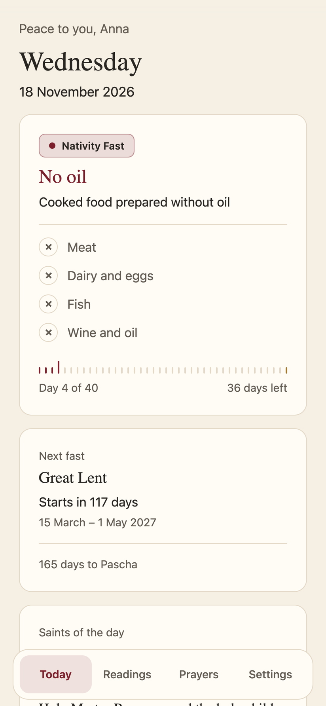</td>
    <td width="33%">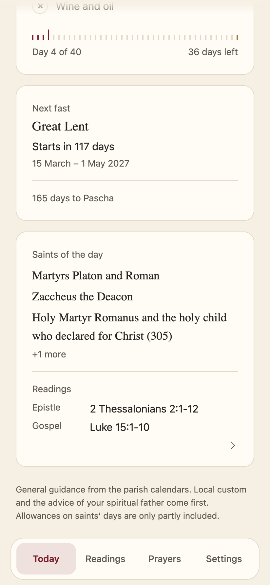</td>
    <td width="33%">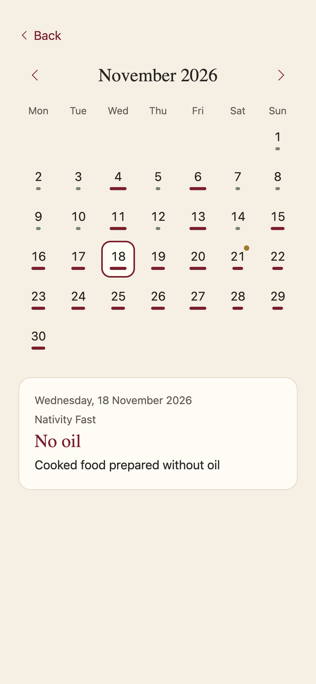</td>
  </tr>
</table>

- The rule for today in plain words, from *no fasting* to *dry eating*, with what is and is not
  allowed: meat, dairy and eggs, fish, wine and oil.
- The four great fasts (Great Lent, the Apostles' Fast, the Dormition Fast and the Nativity
  Fast), the fast-free weeks, Wednesdays and Fridays, and the single fast days such as the eve
  of Theophany and the Beheading of St John.
- Progress through the current fast, the next fast with its dates, and the days left to Pascha.
- A month calendar that marks every fasting day and feast.

### Two traditions, one engine

| | Greek tradition | Russian tradition |
|---|---|---|
| Fixed feasts | New (Revised Julian) calendar | Old (Julian) calendar |
| Fasting customs | Greek practice | Slavic practice |
| Pascha | Julian paschalion | Julian paschalion |

Greek sources disagree about fish in the Nativity and Apostles' Fasts, so the app does not pick
for you. You choose the rule your parish follows (weekends only, the Studite typikon, or every
day but Wednesday and Friday), or leave it on *not sure* and the app shows the stricter reading
and marks the disputed days.

The rules are general guidance from parish calendars. Local custom and the advice of your
spiritual father come first, and the app says so on the Today screen.

### Saints and readings

<table>
  <tr>
    <td width="33%">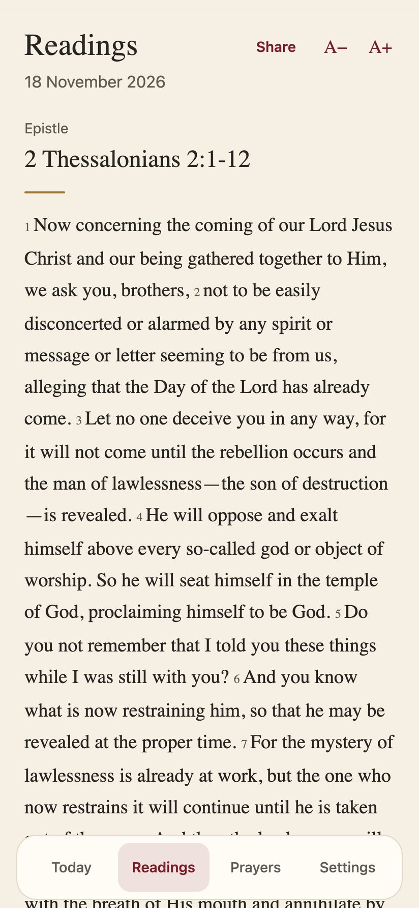</td>
    <td width="33%">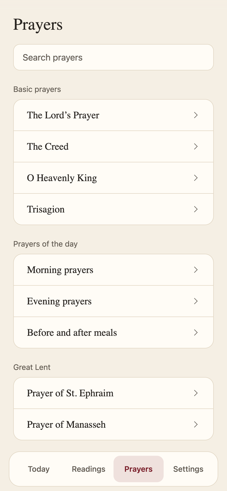</td>
    <td width="33%">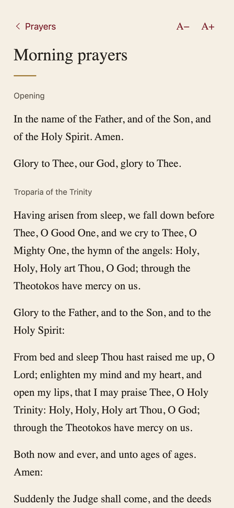</td>
  </tr>
</table>

- The commemorations of each day and the Epistle and Gospel references, bundled for 2026 to 2030
  in both calendars.
- The reading text itself in English and Russian, shipped with the app.
- A link from every reading to the same passage on YouVersion, in the translation that fits your
  language.
- Share the saints and readings of the day as text.

### Prayers

- The Lord's Prayer, the Creed, O Heavenly King and the Trisagion.
- Morning prayers, evening prayers and prayers before and after meals.
- The Prayer of St Ephraim and the Prayer of Manasseh for Great Lent.
- Search across the prayers, and three text sizes in the reader.
- **Your saints.** Name the saints you turn to and what you ask of them. The morning and evening
  prayers then call on them by name.

### On your home screen, and every morning

- A home-screen widget with today's fast, what is allowed, the day's reading and a button to
  mark the day as kept. It comes in a wide and a compact size.
- An optional daily notification with the fast of the day, at 7, 8, 9 or 12 o'clock. It can
  repeat until you open the app.

### Three languages, light and dark

<table>
  <tr>
    <td width="25%">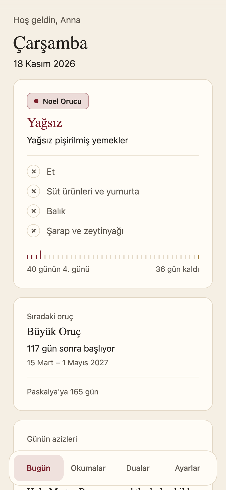</td>
    <td width="25%">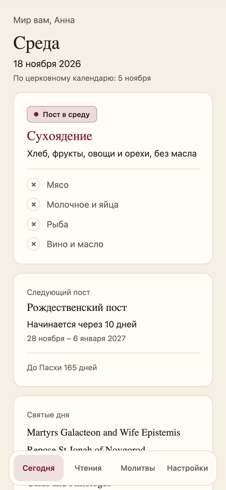</td>
    <td width="25%">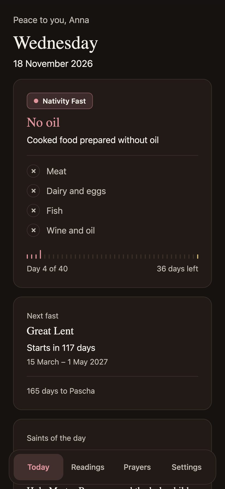</td>
    <td width="25%">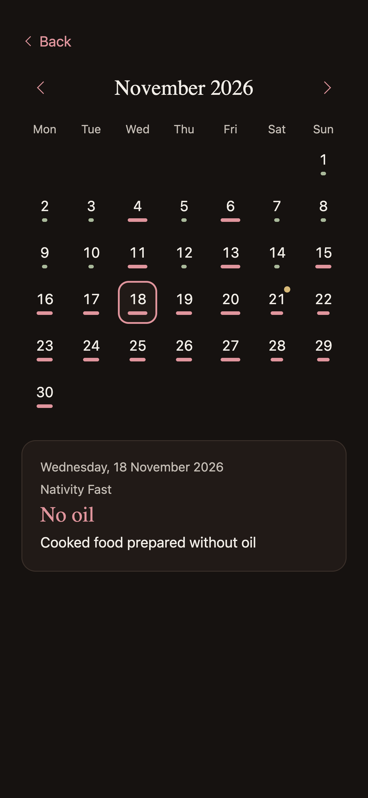</td>
  </tr>
</table>

English, Turkish and Russian, each with its own prayers. The theme follows the system setting.

## Privacy

Poreia has no accounts, no analytics, no advertising and no crash reporting.

- Your settings and the names of your saints stay on your device.
- Notifications are scheduled locally. No push token is created and no server sends them.
- The app talks to the network only to look for its own updates on GitHub, and to open a link
  you tap (a Bible passage on YouVersion, or this project page).

Every request the app makes is listed in [PRIVACY.md](PRIVACY.md). To report a security problem,
see [SECURITY.md](SECURITY.md).

## Install

1. Download the latest signed APK from the
   [Releases page](https://github.com/Kw4nzah/Poreia/releases/latest).
2. Open it on your Android phone and allow the install when Android asks.

The app checks for updates when it starts. New content and small fixes arrive on their own; when
a new APK is needed, the Settings screen offers it.

Poreia is an Android app. There is no iOS build.

## Sources

Every text in the app has a named source, listed in full in
[THIRD_PARTY_NOTICES.md](THIRD_PARTY_NOTICES.md) and inside the app under *Settings → Sources and
licences*.

| What | Source |
|---|---|
| Fasting rules, Slavic practice | Compared day by day with the OCA calendar (orthocal.info) for 2026 |
| Fasting rules, Greek practice | Vima Orthodoxias, the Church of Greece news agency, and the Oropos and Phyli guidelines |
| Saints, feasts and reading references | orthocal.info (Orthodox Church in America lectionary) |
| Scripture, English | Berean Standard Bible and LXX2012, public domain, from eBible.org |
| Scripture, Russian | Synodal Translation (1876), public domain, from eBible.org |
| Prayers, English | *Orthodox Daily Prayers* (St Tikhon's Seminary Press, 1982), with translations prepared for this app |
| Prayers, Russian | Church Slavonic texts in the public domain, checked against azbyka.ru |
| Prayers, Turkish | Translated for this app |

Translations that are under copyright are not stored in the app. The app links to them on
YouVersion instead.

If you serve in a parish and see a rule, a name or a prayer that should be corrected, please
[open an issue](https://github.com/Kw4nzah/Poreia/issues). Corrections from the Church are the
most valuable contribution this project can receive.

## Development

Poreia is built with Expo, React Native and TypeScript.

```bash
npm install            # also applies patches/ through patch-package
npm start              # start the Expo dev server
npm test               # unit tests (vitest)
npm run typecheck      # TypeScript check (tsc --noEmit)
npm run export:android # expo export for Android into dist/
```

Conventions for Expo and React Native code are in [AGENTS.md](AGENTS.md).

### How it is put together

```
src/
  app/            Expo Router screens and layouts (Today, Readings, Prayers, Settings)
  calendar/       Fasting calendar engine; returns ids only
  commemorations/ Saints and readings data, service and Bible links
  i18n/           All user-facing text in en, tr and ru
  notifications/  Daily notification content and schedule
  prayers/        Prayer texts and saint-topic prayers
  screens/        Screen components
  security/       Allowlist for the links the app may open
  settings/       Settings model and provider (AsyncStorage)
  ui/             Shared UI components and theme
  updates/        Over-the-air and APK update checks
  widget/         Home-screen widget
scripts/          Build scripts for reading texts, commemorations, update manifests and icons
assets/           App icons and splash image
patches/          patch-package patches
```

The calendar engine in `src/calendar/` is pure TypeScript with no UI. It returns ids, never
text, and every word the user sees goes through `src/i18n/`. A new jurisdiction is a new entry
of plain data: a fixed calendar and a fasting practice.

### Releases without a store or a server

The whole pipeline runs on GitHub. There is no Expo account and no backend.

- **Push to `main`:** publishes a JavaScript and asset update to GitHub Pages. Installed apps
  download it on the next start.
- **`v*` tag:** builds the signed APK and creates a GitHub release.
- **Native change** (new native module, permission, icon, SDK upgrade): bump `runtimeVersion`
  and the matching number in `updates.url`, `version` and `android.versionCode` in `app.json`,
  then tag. A native change is never shipped as a plain update.
- `patches/expo-updates+*.patch` lets the app accept a manifest from static hosting. Keep it,
  and re-create it when expo-updates is upgraded.

## License

License: not yet chosen.
